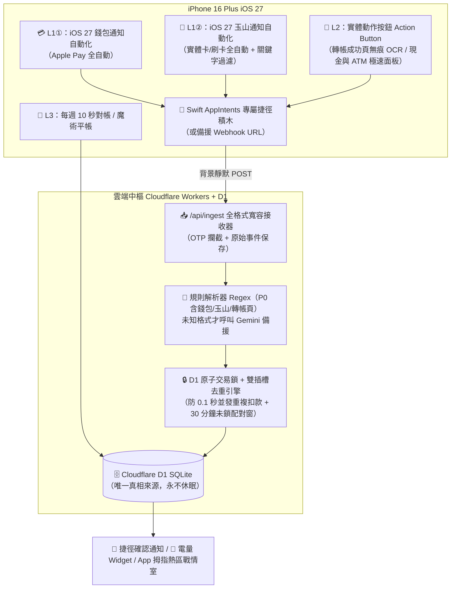

# 🛡️ PocketGuardian（守財靈）— 個人智慧記帳 iOS 原生 App 開發計畫書 (`PLAN.md`)

> **版本**：v3.1（整合 iPhone 16 Plus + iOS 27 實機環境、Cloudflare Workers + D1 後端、原生 `AppIntents` 捷徑專屬積木與 6 大工程防雷修正）
> **專案定位**：專為「討厭繁瑣手動輸入、重視高度原生 iOS 體驗、在 Windows 環境開發並透過 SideStore 安裝 `.ipa`」量身打造的個人財務防禦系統。
> **核心理念**：背景自動捕捉 ＋ 漏記能低成本自癒 ＋ 帳本高容錯柔性平帳 ＋ 衝動消費毒舌勸退。

---

### 📱 使用者實機與帳戶現況（已確認）
- **硬體與系統**：**iPhone 16 Plus**（6.7 吋大螢幕、具備左側實體 **Action Button 動作按鈕**），系統為 **iOS 27**。
- **帳戶結構**：**單一玉山銀行帳戶 + 一張玉山簽帳金融卡**（即時扣款），**沒有信用卡**。
- **消費習慣**：主力為 **Apple Pay** 與 **實體簽帳金融卡**（外加現金与 ATM 存提款）；LINE Pay 剛開通極少用。
- **通知現況**：
  - 玉山 **沒有 Email 通知**。
  - **刷卡**：Apple Pay 會同時跳「iOS 錢包通知」與「玉山 e.Fingo App 推播」；實體金融卡只會跳「玉山 e.Fingo App 推播」。
  - **轉帳**：玉山 App **不會發送轉帳推播通知**，但轉帳成功畫面格式固定（含精確到秒的時間、金額、轉入對象與自己帳號後 5 碼）。轉帳樣本中的 `****24126` 為**朋友帳戶**，自己帳號後 5 碼為 `83151`。
- **iOS 27 捷徑實測**：iOS 27 捷徑內建原生的 **「🔔 當我收到來自『玉山銀行』的通知時」** 觸發器，已實測可正常觸發並擷取通知文字與金額；錢包（Apple Pay）與玉山 App 各設一條自動化捷徑。

### 📝 版本演進紀錄
- **v1 → v2.1**：確立雙軌安全額度、單一玉山帳戶 + 現金模型（移除信用卡負債預設）、新增常用轉帳對象（`payees`）、本機 OCR 只傳文字不留相簿、MVP 分期交付。
- **v3**：依實測確認 iOS 捷徑具備「收到通知時」觸發器 → 實體卡刷卡（e.Fingo 推播）改為**全自動入帳**；雲端改採「**事件 (`events`) → 交易 (`transactions`)**」兩層模型合併，餘額只依交易計算；加入 OTP 關鍵字過濾保護。
- **v3.1（當前版本）**：
  1. **雲端後端改為 Cloudflare Workers + D1 (SQLite)**（取代 Supabase）：完美銜接使用者既有 `*.workers.dev` 環境，**永不因 7 天閒置而休眠**，速度最快。
  2. **內建 iOS 原生捷徑專屬模組（Swift `AppIntents`）**：在 `.ipa` 內直接提供「🛡️ 守財靈：智慧入帳」等專屬捷徑積木，接在 iOS 27「當收到通知時」下方即可使用，免手刻複雜 HTTP JSON，且**不額外消耗 SideStore App ID 額度**。
  3. **iPhone 16 Plus (iOS 27) 專屬優化**：
     - **6.7 吋單手大拇指熱區 (Bottom Thumb-Zone UI)**：上半部看數據，下半部 45% 放所有點擊操作。
     - **實體動作按鈕 (Action Button) 整合**：一按即可觸發「轉帳成功頁無痕擷取」或「現金／ATM／罵醒我極速面板」。
     - **編譯相容鎖定**：`.ipa` 最低相容門檻設為 `iOS 17.0+`（確保 GitHub Actions 雲端 Xcode 100% 編譯通過，並在 iOS 27 上完美執行與銜接新捷徑觸發器）。
  4. **6 大工程防踩雷修正**：
     - D1 資料庫 **原子鎖（防 0.1 秒雙捷徑同時抵達的 Race Condition 重複扣款）**。
     - 跨通道未上鎖配對窗由 3 分鐘拉長至 **30 分鐘**（防地下室/訊號差推播延遲導致重複扣款；配對完成即刻 `is_locked = true` 上鎖）。
     - Webhook **全格式寬容解析**（JSON / 純文字 / Form / Query 皆可收）+ App 內建「捷徑連線測試台」。
     - **轉帳成功頁規則解析提早至 P0** 實作（搭配 Action Button 無痕截圖 OCR 與「關閉玉山 App 防忘記提醒」選配）。

---

## 1. 技術棧與「1 + 3 終極合體」架構

本專案採用 **「原生 `.ipa` 封裝（含 Swift Widget + Swift `AppIntents`）＋ 秒級熱更新開發」** 的混合架構，兼具 100% iOS 原生體驗與 Windows 極速開發效率。

| 層級 | 技術選型 | 職責與備註 |
| :--- | :--- | :--- |
| **App 本體 (iOS Native)** | **Expo (React Native + TypeScript)** | 編譯為真正 iOS 原生 UI，針對 **iPhone 16 Plus (6.7")** 採底部拇指熱區排版，支援原生手勢、Taptic 實體震動回饋、自訂 Deep Link (`myledger://`)。 |
| **捷徑專屬積木** | **Swift (`AppIntents`)** | 內建於主程式 Target（**0 額外 App ID 消耗**）。在 iOS 27「捷徑」App 中直接顯示專屬動作積木（如 `🛡️ 智慧入帳`、`💵 快速記帳`），設定 `openAppWhenRun = false` 背景靜默執行不跳畫面。 |
| **桌面 & 鎖定畫面小工具** | **Swift (`WidgetKit`) + `@bacons/apple-targets`** | 與主程式打包在同一個 `.ipa`。**Widget 直接用 `URLSession` 向 Cloudflare 唯讀端點 `/api/widget-summary` 取得彙總數字**（不依賴 App Group，避開免費簽名限制）。備案：Scriptable 小工具。 |
| **熱更新與開發** | **`expo-dev-client` + `expo-updates` (OTA)** | Windows 上秒級 Fast Refresh；裝進 SideStore 後，95% 的 UI／邏輯／公式修改透過 15 秒雲端 OTA 熱更新生效，**無需重編 `.ipa`**。 |
| **自動化編譯與安裝** | **GitHub Actions (`macos-latest`) + SideStore** | 使用公開 repo（金鑰放 Secrets），對所有 Target 強制設定 `CODE_SIGNING_ALLOWED=NO` 與 `MinimumOSVersion = 17.0`（向上完美相容 iOS 27），自動產出未簽名 `.ipa` 與 SideStore Source JSON。 |
| **雲端大腦與資料庫** | **Cloudflare Workers + D1 (SQLite)** | **唯一真相來源（永不休眠）**。接收 `AppIntents` 或 Webhook 請求、執行原子鎖去重與計算。App 同時具備本機快取與離線寫入佇列（支援尚未填寫雲端網址時於本機獨立測試所有功能）。 |
| **資料解析** | **通知文字／轉帳頁 OCR 文字 → 規則解析 (Regex) → Gemini 備援** | 通知文字由捷徑直接送出；轉帳成功頁用捷徑本機 OCR（「從圖像擷取文字」），圖片只存在 RAM、**不進相簿**。玉山格式固定，規則優先；格式不明才呼叫 Gemini（只送文字）。 |
| **回饋與推播** | **捷徑原生通知 + Bark（選配）** | 刷卡當下由捷徑顯示雲端回傳的確認通知；雲端主動預警可搭配 Bark，點擊以 `myledger://` 跳轉。 |

### SideStore 注意事項
- 免費 Apple ID：每 7 天需續簽、最多同時 3 個 App、每週 10 個 App ID（主程式含 `AppIntents` 佔 1 個 + Widget 佔 1 個 ＝ **共 2 個 App ID**）。
- App 內顯示「簽名到期倒數」。若偶爾忘記續簽導致 App 暫時過期，除可一鍵刷新外，捷徑亦可直接使用傳統 `取得 URL 內容` 打同一個 Cloudflare 端點，**入帳永不中斷**。

---

## 2. 全自動捕捉與防打架設計（依實測樣本與 iOS 27 環境）

### 2.1 實測樣本事實與處理方式

| 場景 | 實測現象 | 捕捉與處理方式 |
| :--- | :--- | :--- |
| **Apple Pay 刷卡** | 同一筆消費幾乎同時產生**兩則**通知：<br>① iOS 錢包通知：`樂家康, 新北市新店區 $81.00`（有商店、有金額）<br>② 玉山 e.Fingo 推播：`簽帳金融卡消費 81元通知`（只有金額，無商店） | 兩條 iOS 27 通知自動化捷徑各自觸發 `🛡️ 智慧入帳` 積木送往 Cloudflare；雲端透過 **D1 原子鎖 + 雙插槽配對** 合體為單一筆 `$81` 交易（保留錢包的商店名稱 `樂家康`），**絕不扣兩次錢**。 |
| **實體金融卡刷卡** | 只會跳出玉山 e.Fingo 推播：`簽帳金融卡消費 81元通知`。 | 由玉山通知自動化捷徑 **100% 全自動** 入帳；因通知無商店名稱，先依時段與歷史金額猜測分類（或標為「未分類」），確認通知附快速分類入口。 |
| **網銀轉帳** | 玉山 App **不會發送轉帳推播**。轉帳成功頁文字固定：`交易成功` + `2026-10-26 02:07:37` + `轉帳金額 100` + `轉入對象 808...24126` + `自己帳號 808...83151`。 | **P0 直接內建轉帳頁 Regex 解析器**！在成功頁長按一下 **iPhone 16 Plus 左側動作按鈕 (Action Button)**，捷徑瞬間無痕截圖 OCR（不存相簿）並完成入帳。「時間(秒)+金額+對象後5碼」構成完美冪等鍵。 |
| **OTP 驗證碼過濾** | 玉山 App 也會發送登入／交易驗證碼或活動推播。 | **雙重防護**：① 捷徑設定過濾條件（僅包含「消費」或「轉帳／入帳」字樣才觸發）；② 雲端收到含「驗證碼 / OTP」或純 6 位數驗證格式時**立即丟棄不落盤**。 |

### 2.2 三層捕捉漏斗

| 層級 | 做法 | 涵蓋範圍 | 使用者操作成本 |
| :--- | :--- | :--- | :--- |
| **L1 全自動（0 操作）** | iOS 27「當收到通知時」自動化 → 呼叫 `🛡️ 守財靈：智慧入帳` 積木：<br>① 錢包（Apple Pay）自動化<br>② 玉山銀行（e.Fingo）自動化 | Apple Pay 刷卡、實體金融卡刷卡 | **0（完全無感）** |
| **L2 動作按鈕一鍵（1 秒）** | 按下 **iPhone 16 Plus 動作按鈕 (Action Button)**：<br>① 若畫面為玉山「交易成功（轉帳）」→ 自動無痕截圖 OCR 入帳（不進相簿）<br>② 一般畫面 → 彈出「💵 現金快記 / 🏧 ATM 提款 / 💸 補記轉帳」極速面板<br>*(選配：關閉玉山 App 時若 3 分鐘內無紀錄，自動輕提示是否剛才轉帳或對帳)* | 網銀轉帳、現金消費、ATM 存提款 | **按 1 下動作按鈕** |
| **L3 自動自癒補漏** | ① **餘額錨點**：任何含餘額的畫面自動校正帳戶<br>② **每週 10 秒對帳**：輸入玉山 App 上的實際餘額，搭配「⚖️ 魔術平帳」一鍵抹平差額 | 薪資入帳、朋友還錢、任何漏網之魚 | **每週約 10 秒** |

### 2.3 架構流程圖



### 2.4 去重與防打架引擎 v3.1（解決 0.1 秒並發與連買兩次）

採「**事件 (`events`) → 交易 (`transactions`)**」兩層模型，**帳戶餘額永遠只依 `transactions` 計算**。每筆交易具備兩個配對插槽：
- `frontend_slot`：`apple_pay` | `manual` | `null`
- `bank_slot`：`efingo_push` | `transfer_page` | `null`

| 規則 | 觸發情境與防禦邏輯 |
| :--- | :--- |
| **0. 原子排隊鎖（防 0.1 秒雙捷徑並發）** | 當 Apple Pay 與 e.Fingo 通知在同一秒打進 Cloudflare Workers 時，透過 D1 交易序列化與金額指紋鎖，強制第 2 個請求等待第 1 個請求完成寫入後再執行比對，**徹底杜絕並發 Race Condition 重複扣款**。 |
| **1. 冪等鍵（防重複觸發／重複截圖）** | • **轉帳頁**：`hash(交易時間精確到秒 + 金額 + 轉入對象後5碼)`，完全相同即略過，真轉兩次因秒數不同必為兩筆。<br>• **通知**：同一來源、文字相同、10 秒內重複收到 → 視為 iOS 重複觸發並略過。 |
| **2. 同源連發必新增（連買兩次同商品）** | 若待配對交易的**同一個插槽已經有值**（例如連收到兩筆 `apple_pay $55`，或連收到兩筆 `efingo_push $55`），100% 判定為**「買了第二次」**，立即建立第 2 筆獨立交易！ |
| **3. 30 分鐘跨源配對與滿載上鎖 (`is_locked`)** | • 當收到 `apple_pay $81`（前端位有值、銀行位空缺）與 `efingo_push $81`（銀行位），只要兩者金額相同且在 **30 分鐘內**（防止地下室訊號延遲推播），即自動合體為同一筆交易，保留錢包的商店名稱 `樂家康`。<br>• **一旦雙插槽湊滿，立即標記 `is_locked = true` 上鎖關門 🔒**！此後就算 1 分鐘後又買了一筆 `$81`，因前筆已上鎖，必開立全新交易。 |
| **4. 預授權／小費金額調整** | 同卡、同商店、2 小時內且金額差距在 ±20% 內 → 自動更新原交易金額並標記「金額已調整」，不重複扣款。 |
| **5. 一鍵「✂️ 拆成兩筆」反悔鈕** | 任何經由系統合體的交易，在明細頁皆附帶 **【✂️ 我真的買了兩次，點此拆成兩筆】** 按鈕，由 `merged_metadata` 瞬間無損還原為兩筆獨立消費。 |

---

## 3. 核心功能與「iPhone 16 Plus 柔性 UX」規格

### 3.1 單手大拇指熱區排版 (6.7" Thumb-Zone Ergonomics)
- **螢幕上半部 55%（視覺資訊區）**：
  - 🔋 **電量式今日安全額度大卡片**（綠／黃／紅三色氣象台）
  - 🏦 **玉山銀行餘額**、💵 **現金餘額**、🛡️ **真正總可用餘額**（扣除本月尚未發生的固定扣款預留）
  - 🐸 **小錢花太多（溫水煮青蛙）預警橫幅**
- **螢幕下半部 45%（單手大拇指操作熱區）**：
  - 底部常駐單手可及的 **4 大極速動作鍵**：`[💵 3秒記現金]`、`[🏧 ATM 存提同步]`、`[🛑 罵醒我]`、`[⚖️ 魔術平帳]`
  - 內建大型單手數字鍵盤與常用籌碼（`早餐 $65`、`便當 $110`、`飲料 $55`、`轉帳給朋友`）。

### 3.2 雙軌制「今日安全額度」公式
- **真正總可用餘額**：
  $$\text{真正總可用餘額} = (\text{玉山銀行餘額} + \text{手頭現金}) - \text{本月尚未發生的固定扣款}$$
- **雙軌安全額度**（每條軌道各自只扣一次未發生固定扣款，絕不重複扣除）：
  - **軌道 A（預算控管）**：`(月目標預算上限 − 本月已花 − 本月尚未發生的固定扣款) ÷ 距離結算日剩餘天數`
  - **軌道 B（防破產底線）**：`(真正總可用餘額 − 銀行保底不可動存款) ÷ 距離結算日剩餘天數`
  - **今日可花安全額度** ＝ 取軌道 A 與軌道 B 較小值。

### 3.3 🛑「罵醒我」與 🐸「小錢花太多」雷達
- **罵醒我**：輸入想買的商品與金額，結合今日剩餘額度、本月超商/飲料小錢次數、**⏳ 苦命時薪與雞腿便當換算** 進行勸退（支援切換：毒舌損友／殘酷數據／暴躁老媽模式）。點擊【😤 我忍住了】將金額記入榮譽榜；點擊【💸 剁手也要買】直接轉入記帳。
- **小錢雷達**：自動監控單筆 `< $200` 消費，連續 3 天或單週超過 7 次／累計破 `$1,000` 時主動警告。

### 3.4 柔性容錯機制
- **⚖️ 魔術平帳（餘額對帳矯正）**：輸入玉山 App 或錢包裡的實際金額，系統算出差額後提供「快速補記（含薪資/朋友還錢 `income`）」或「✨ 柔性抹平（平均攤提至過去 7 天，或從本月預算扣除但不影響今日心情）」。
- **🛡️ 防誤觸二次確認撤銷 (Safe Undo)**：任何撤銷、清空、刪除按鈕嚴禁單擊生效。第 1 下點擊觸發 Taptic 震動並轉為琥珀色 **「再按一次確認撤銷（3 秒自動取消）」**，且刪除後保留於 **7 天回收桶** 隨時可救回。

---

## 4. 五大防棄坑創意功能

1. **🔋 電量式 Swift 原生鎖定畫面／桌面小工具**：在 iPhone 16 Plus 鎖定畫面與桌面以電池百分比顯示今日安全額度，每 15 分鐘自動向 Cloudflare `/api/widget-summary` 更新並顯示更新時間。
2. **👻 固定扣款幽靈預警**：管理定期扣款（Netflix、Spotify、iCloud、電話費），月初先從可用餘額預留，扣款前 2 天預警，當日自動入帳。
3. **⏳ 苦命時薪／雞腿便當換算**：自動把金額換算成「要工作 X 小時／等於 Y 個雞腿便當」。
4. **🌙 晚間 10 秒結算與省錢小金庫**：每晚將沒花完的今日安全額度存入「🐷 省錢成就小金庫」。
5. **🧾 電子發票載具品項補完（列為 P3 選配）**。

---

## 5. Cloudflare D1 資料庫結構 (SQLite Schema)

1. **`accounts`**：`id`, `name`（玉山銀行 / 現金錢包）, `type` (`bank` | `cash` | `debit_card`), `balance`, `account_suffix`（預設 `83151`）, `linked_account_id`, `last_reconciled_at`, `updated_at`
2. **`transactions`**：
   - `id` (UUID), `amount`, `type` (`expense` | `income` | `transfer` | `adjustment`), `category`, `merchant`, `note`
   - `account_id`, `to_account_id`, `payee_id`
   - `frontend_slot` (`apple_pay` | `manual` | null), `bank_slot` (`efingo_push` | `transfer_page` | null)
   - `idempotency_key` (UNIQUE), `is_locked` (INTEGER 0/1), `merged_metadata` (TEXT JSON — 供一鍵拆單無損還原)
   - `time_source` (`absolute` | `notification_received`), `is_micro_spend` (INTEGER 0/1), `deleted_at`, `occurred_at`, `created_at`
3. **`events`（原始事件紀錄表）**：`id`, `source` (`wallet` | `efingo` | `transfer_page` | `manual`), `raw_text`, `received_at`, `parsed_json`, `transaction_id`, `status` (`merged` | `new_tx` | `duplicate` | `discarded_otp` | `parse_failed`)
4. **`payees`（常用轉帳對象表）**：`id`, `bank_code`（如 `808`）, `account_suffix`（如 `24126`）, `display_name`（如「朋友」）, `default_category`
5. **`subscriptions`（固定扣款表）**：`id`, `name`, `amount`, `billing_day_of_month`, `account_id`, `is_active`, `last_charged_month`
6. **`budget_settings`**：`monthly_budget_limit`, `cycle_start_day`, `safety_floor_amount`, `hourly_wage`, `bento_price`, `piggy_bank_saved`, `resisted_impulse_total`

---

## 6. 專案目錄與實作階段規劃

專案根目錄：`C:\Users\mrhai\.gemini\antigravity\scratch\smart-ledger`

```text
smart-ledger/
├── PLAN.md
├── app.json                         # Expo 配置 (URL Scheme myledger://、iOS 17.0+ 相容 iOS 27、Widget 與 AppIntents)
├── package.json
├── core/                            # 共用 TypeScript 核心（App 與 Cloudflare Worker 共用同一份邏輯）
│   ├── parsers/                     # 錢包通知 / 玉山 e.Fingo 推播 / 轉帳成功頁 Regex 解析器 + OTP 過濾器
│   ├── dedupe.ts                    # 原子配對鎖、30分鐘跨源合體、同源必新增、一鍵拆單還原
│   └── safeToSpend.ts               # 雙軌安全額度、溫水煮青蛙雷達、時薪/便當體感換算
├── src/
│   ├── store/                       # 本機快取 + 離線獨立運作 + Cloudflare 雲端同步佇列
│   ├── components/                  # 6.7" 單手拇指熱區元件（電量卡、餘額看板、ATM/現金面板、罵醒我、魔術平帳、安全撤銷）
│   └── screens/                     # 戰情室首頁、帳目明細（含✂️拆單鈕）、固定扣款、iOS 27 捷徑設定與模擬測試台
├── targets/
│   ├── widget/                      # 🍎 Swift WidgetKit（鎖定畫面 + 桌面電量小工具）
│   └── app-intents/                 # 🧩 Swift AppIntents（iOS 捷徑專屬動作積木：智慧入帳 / 快速記帳 / 查額度）
├── cloudflare-worker/
│   ├── wrangler.toml                # Cloudflare Workers + D1 設定檔
│   ├── schema.sql                   # D1 SQLite 資料表結構與索引
│   └── src/index.ts                 # /api/ingest 全格式寬容接收器、原子鎖去重、/api/widget-summary
└── .github/workflows/
    └── build-sidestore-ipa.yml      # 🚀 GitHub Actions 自動編譯免簽名 .ipa 與 SideStore Source JSON
```

### 分階段交付里程碑
- **P0（第一階段核心交付）**：
  1. `core/` 解析與去重引擎（內建你提供的 `$81 樂家康 + e.Fingo 雙通知`、`轉帳 $100 給 24126`、`連買兩次` 完整單元測試）。
  2. `cloudflare-worker/` 完整後端與 D1 Schema。
  3. iPhone 16 Plus 單手拇指熱區 App 介面（電量安全額度、銀行/現金餘額、3秒現金、ATM 同步、二次確認撤銷、魔術平帳、內建捷徑防打架模擬測試台）。
- **P1（防棄坑強化與原生封裝）**：
  4. 罵醒我毒舌勸退機（含時薪/便當換算）、小錢雷達、固定扣款幽靈預警、晚間結算小金庫。
  5. Swift `WidgetKit` 電量小工具 + Swift `AppIntents` 捷徑專屬積木 + GitHub Actions `.ipa` 自動打包腳本。
- **P2 / P3（後續擴充）**：
  6. 代墊款項沖銷標記、LINE Pay／街口／全支付、電子發票載具明細、選配信用卡支援。
